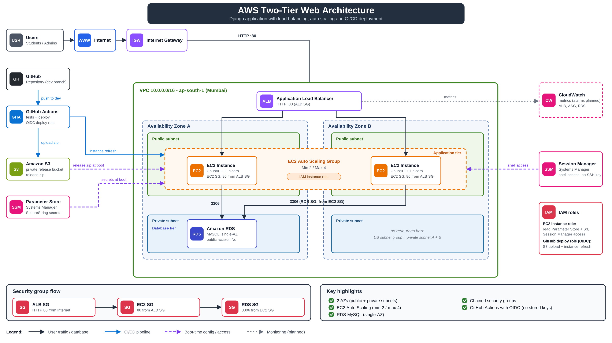

# AWS Two-Tier Web Architecture

A Django application deployed on AWS as a production-style two-tier setup: a load balancer in front of auto-scaled app servers, backed by a private database. The app was previously hosted on Render. This project moves it to self-managed infrastructure to learn how load balancing, scaling, networking, security, and automated deployments work together.

**AWS services:** VPC, EC2 Auto Scaling, Application Load Balancer, RDS MySQL, S3, Systems Manager (Parameter Store and Session Manager), IAM
**Tooling:** GitHub Actions (OIDC), Gunicorn, systemd

## Architecture

- **Application tier:** EC2 instances (Ubuntu + Gunicorn) in an Auto Scaling Group (min 2, max 4) across two AZs, behind an Application Load Balancer.
- **Database tier:** RDS MySQL in a private subnet, with no public access. The DB subnet group spans two private subnets in different AZs.
- **Traffic flow:** `Browser → ALB → EC2 instances → RDS`
- **Security groups are chained:** the ALB accepts port 80 from the internet, the EC2 group accepts port 80 only from the ALB, and the RDS group accepts port 3306 only from the EC2 group.

## Key decisions

| Decision | Why |
|---|---|
| RDS MySQL instead of a local database file | Several instances need to share one database |
| 2 AZs, public and private subnets | The ALB and RDS need two AZs, and the database stays off the internet |
| Chained security groups | Each tier trusts only the tier in front of it |
| IAM instance role + Parameter Store | No passwords or AWS keys in code, in Git, or on disk |
| Release zip in S3, pulled at boot | Every instance runs the same build, with no GitHub credentials on servers |
| Session Manager, no SSH key | Port 22 is never open |
| GitHub Actions with OIDC | Deploys without stored AWS keys, scoped to this repo and branch |
| Single-AZ RDS | Free tier limit. The subnet group already spans two AZs, so Multi-AZ is a setting change |

## Deployment flow

1. Push to `dev`.
2. GitHub Actions runs automated checks against a MySQL container.
3. If they pass, it builds a zip from the committed code and uploads it to S3 (a commit-named copy for rollback, plus `release.zip`).
4. It starts an ASG instance refresh, which replaces instances gradually so the site stays up.
5. Each new instance downloads the zip, fetches secrets from Parameter Store using its IAM role, and starts Gunicorn under systemd.

## Security

- RDS has no public access and sits in private subnets
- Only the ALB can reach the app servers, and only the app servers can reach the database
- Secrets live in Parameter Store (SecureString), loaded into a root-only env file
- Instances require IMDSv2 and have no SSH key
- The deploy role can only upload to one bucket and start an instance refresh
- The release zip is built from committed code only (no `.env`, `venv`, or database file)

**Known gaps:** the site serves HTTP only (HTTPS via CloudFront or ACM is planned), app servers sit in public subnets, the app connects with the RDS master user, RDS is single-AZ, and database migrations are run by hand once.

## Troubleshooting

| Symptom | Cause | Fix |
|---|---|---|
| Targets unhealthy, boot script stopped with S3 `403` | IAM policy resource was `arn:aws:s3:::bucket`, missing `/*` | Added `/*` so the policy covers objects |
| Database login failed with `1045 Access denied` | Password in Parameter Store didn't match RDS | Set both to the same value |
| GitHub Actions: `Not authorized to perform sts:AssumeRoleWithWebIdentity` | The token subject included numeric owner and repo IDs, so my trust policy didn't match | Printed the token's `sub` claim and used the exact value |
| `2005 Unknown MySQL server host` after recreating RDS | Parameters are read only at instance boot | Updated `DB_HOST`, then ran an instance refresh |
| Browser got `502` while `curl` got `200` | The health check skips the database, but requests with a session cookie query it. With RDS stopped, Gunicorn timed out and the ALB returned 502 | Diagnosed with ALB metrics and `journalctl`; added a DB connect timeout |
| `1050 Table already exists` | An interrupted `migrate` left tables without migration records | Recreated the empty database and ran `migrate` once |
| Site opened on desktop but not on a phone | The phone browser forced HTTPS, and the ALB only serves port 80. `curl` returned 200 | Confirmed with `curl`; HTTPS is the planned fix |

## Cost and cleanup

The ALB, RDS, and EC2 instances are the main costs. They are recreated for demos and deleted afterwards, while the VPC, security groups, target group, launch template, S3 bucket, parameters, and pipeline stay in place, so a rebuild takes about 15 minutes. Everything is tagged `Project=mess-app` so leftover resources are easy to find.

## Next steps

HTTPS with CloudFront or ACM, CloudWatch alarms and a dashboard, a limited database user for the app, app servers in private subnets with NAT, Multi-AZ RDS, and rebuilding the infrastructure with Terraform.